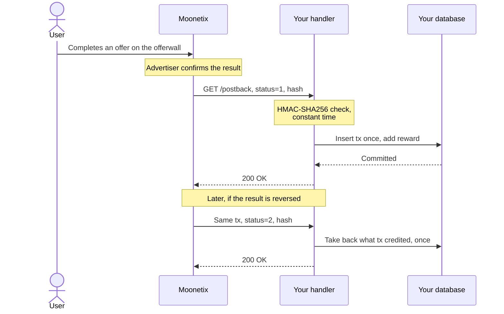

# Moonetix offerwall postback handlers

**Credit offerwall rewards safely: one small, tested postback handler in PHP, Node.js, Python, and Java.**

[](https://github.com/moonetix/offerwall-postback-handlers/actions/workflows/ci.yml)
[](LICENSE)
[](https://docs.moonetix.com/postbacks)
[](https://moonetix.com/register?from=github-offerwall-postback-handlers)
[](https://moonetix.com/tools/postback-hash-checker)
[](#handlers)
[](#handlers)

Moonetix is an affiliate network. Publishers add its offerwall, and their users earn the publisher's own currency by completing offers. When an offer is credited or reversed, Moonetix calls your postback URL. This repo has a ready handler for that URL in four languages.

> [!TIP]
> **Get your App ID and keys: sign up free at https://moonetix.com/register?from=github-offerwall-postback-handlers**
> Then read [docs.moonetix.com/postbacks](https://docs.moonetix.com/postbacks) and check a hash with the free [postback hash checker](https://moonetix.com/tools/postback-hash-checker).

## What these handlers guarantee

1. **No double credits.** Every handler credits each `transaction_id` once, also when Moonetix retries or the same postback arrives 10 times at once. The tests prove it.
2. **Reversals done right.** Status 2 takes back exactly the amount that was credited, from the user who got it, and only once. A reversal for a transaction you never credited changes nothing.
3. **Tested against real postbacks.** The shared test data was produced by the Moonetix postback code itself. Every handler runs the same 20 cases, including tampered and wrongly signed requests.

No frameworks and no packages to install. Each handler is one file you can read in a few minutes.

## Handlers

| Folder | Stack | Storage | Run | Test |
| --- | --- | --- | --- | --- |
| [php/](php/) | PHP 8.1+, PDO SQLite | SQLite | `php -S 127.0.0.1:8080 -t public` | `php test.php` |
| [node/](node/) | Node.js 22, `node:http`, `node:sqlite` | SQLite | `npm start` | `npm test` |
| [python/](python/) | Python 3, `http.server`, `sqlite3` | SQLite | `python3 handler.py` | `python3 test_handler.py` |
| [java/](java/) | Java 17+, `com.sun.net.httpserver` | In memory, swap in your database | `java Handler.java` | `./test.sh` |

## Quick start

You need your postback secret key. Find it on the Postback page of your [Moonetix dashboard](https://moonetix.com/register?from=github-offerwall-postback-handlers).

```sh
git clone https://github.com/moonetix/offerwall-postback-handlers.git
cd offerwall-postback-handlers
cp .env.example .env            # put your postback secret key in .env
set -a; . ./.env; set +a        # load it into your shell

cd node && npm start            # or: cd python && python3 handler.py
                                # or: cd java && java Handler.java
                                # or: cd php && php -S 127.0.0.1:8080 -t public
```

The handler now answers on `http://127.0.0.1:8080/postback` (PHP: `/postback.php`). Put it behind your web server with HTTPS, then save this postback URL on the Postback page of your dashboard:

```text
https://yoursite.com/postback?user={user_id}&tx={transaction_id}&event={event_id}&status={status}&reward={reward}&payout={payout}&hash={hash}
```

### Configuration

All four handlers read the same environment variables.

| Variable | Required | Default | Used by | Purpose |
| --- | --- | --- | --- | --- |
| `MOONETIX_POSTBACK_KEY` | yes | none | all | Postback secret key. Without it Node, Python and Java exit with `Set MOONETIX_POSTBACK_KEY first.` and PHP answers `500 Not configured`. |
| `HOST` | no | `127.0.0.1` | Node, Python, Java | Listen address. Keep it on loopback behind a reverse proxy. |
| `PORT` | no | `8080` | Node, Python, Java | Listen port. For PHP, the port is the one you pass to `php -S` or your web server. |
| `DB_PATH` | no | `data/moonetix.sqlite` in the handler folder | PHP, Node, Python | SQLite file. Keep it outside the web root. Java keeps balances in memory until you plug in your database. |

## Test it in 30 seconds

No keys and no Moonetix account needed. Each folder has a test script that starts the handler, sends the 20 postbacks in [testdata/postbacks.json](testdata/postbacks.json), and checks every answer and every balance.

```sh
(cd php && php test.php)
(cd node && npm test)
(cd python && python3 test_handler.py)
(cd java && ./test.sh)
```

```text
ok    credit
ok    duplicate credit (retry) is skipped
ok    reversal takes the credit back
ok    reversal without credit is ignored
ok    tampered reward is rejected
ok    wrong key is rejected
ok    same credit sent 10 times in parallel is paid once
...
20 passed, 0 failed
```

The test data is signed with a test key that is in the file. It is not a real key.

Once you have adapted a handler to your own database, point [postback-tester](https://github.com/moonetix/postback-tester) at it. It builds postbacks exactly like Moonetix, signed with the key the quick start loaded from `.env`, and checks the same rules from the outside, including five parallel copies of one credit:

```sh
npx github:moonetix/postback-tester --preset moonetix \
  'http://127.0.0.1:8080/postback?user={user_id}&tx={transaction_id}&event={event_id}&status={status}&reward={reward}&payout={payout}&hash={hash}' --user 42
```

## How it works



For every request, each handler does this, in this order:

1. Reads `tx`, `user`, `reward`, `status`, and `hash` exactly as they arrive.
2. Computes the expected hash and compares it in constant time. A missing hash gets 400. A wrong hash gets 403. Nothing else runs before this check.
3. Checks the signed values: status is 1 or 2, reward is a non-negative number, the user ID uses the allowed characters. Anything else gets 400.
4. In one database transaction:
   - **Status 1:** inserts `tx` into a table where it is the primary key. Only if the insert worked, it adds the reward to the user's balance.
   - **Status 2:** if `tx` was credited, marks it reversed and subtracts the stored amount from the stored user. If `tx` is unknown, it stores `tx` as reversed so that a late credit is never paid.
5. Answers `200 OK` only after the transaction is committed. If storing fails, it answers 500, and Moonetix tries again later.

Rewards are stored as whole millionths in integer columns, so 0.75 + 1.23456 adds up exactly. No floating point.

### The hash formula

`{hash}` is the HMAC-SHA256, as lowercase hex, of four values joined with colons, signed with your postback secret key:

```text
hash = hex( HMAC-SHA256( key = postback secret key,
                         message = transaction_id + ":" + user_id + ":" + reward + ":" + status ) )
```

Example: `tx_1001:42:150:1`. Use the values exactly as they arrive, after URL decoding. Do not reformat the reward: `150` and `150.00` give different hashes. The postback secret key is not the link hash salt. To check a single postback by hand, paste it into the [postback hash checker](https://moonetix.com/tools/postback-hash-checker).

## Security notes

- The postback secret key comes only from the `MOONETIX_POSTBACK_KEY` environment variable. Never put it in a page, an app, or Git.
- The hash is checked first, with a constant-time comparison (`hash_equals`, `crypto.timingSafeEqual`, `hmac.compare_digest`, `MessageDigest.isEqual`).
- `payout`, `event`, `offer_id`, and the other macros are not signed. Use them for logs, never for money.
- Each `transaction_id` is credited once, enforced by a primary key, not only by a check in code.
- Status 2 only takes back what was credited. Amounts are never negative; the status says add or take back.
- The answer is 200 only after the change is stored. A 200 for an ignored or repeated event is correct: it stops retries.
- Build the offerwall link on your server, for the signed-in user only. Never trust a user ID sent from the browser or the app. See [Offerwall link](https://docs.moonetix.com/offerwall-link).
- Reward users only for completed offers. Never reward joins, invites, likes, reviews, or other engagement. Users must be 16 or older.
- Optional extra layer: allow only the Moonetix IP addresses listed in [Postbacks](https://docs.moonetix.com/postbacks#ip-addresses). Always check the hash as well.

## Test with Moonetix

When your handler runs on a public HTTPS URL:

1. Save your postback URL on the Postback page of your dashboard.
2. Open Offerwalls, your offerwall, Integration, and click **Send a test postback**. You can also send one from the Postback page.
3. Pick a user ID, a status, and a payout. The result window shows what your server answered. Every attempt is also listed under Reports, Postbacks.
4. Send status 1, then status 2 for the same user. Check that the balance goes up and back down.

A test postback has a `transaction_id` that starts with `test_` and `offer_id` 0. These handlers credit it like a real one, so remove test rewards from your test accounts before going live.

## When a postback fails

Reports, Postbacks in your dashboard shows the code your handler answered. The handlers answer with these codes and plain-text bodies:

| Answer | Meaning | Fix |
| --- | --- | --- |
| `400 Missing hash` | No `hash` parameter, or it is not 64 hex characters. | Check that the saved postback URL contains `hash={hash}` spelled exactly like that. |
| `403 Invalid hash` | The hash does not match. | Use the postback secret key, not the link hash salt. Do not trim, round or reformat values before hashing. Paste the URL from the log into the [hash checker](https://moonetix.com/tools/postback-hash-checker). |
| `400 Bad parameters` | Signed, but `status` is not 1 or 2, `reward` is not a plain non-negative number, `tx` is empty or longer than 191 characters, or the user ID has characters outside `A-Z a-z 0-9 . _ @ : + -`. | Map the macros to the right parameter names: `user`, `tx`, `status`, `reward`, `hash`. |
| `404 Not found` | Wrong path. | Node, Python and Java answer on `/postback` only; PHP on `/postback.php`. |
| `500 Not configured` (PHP) or `500 Error` | No key set for PHP, or the database write failed. Moonetix retries. | Check that the web server passes `MOONETIX_POSTBACK_KEY` to PHP and that `DB_PATH` is writable by the server user. |

Two failures never reach the handler at all: a redirect (Moonetix does not follow 301 or 302, so save the final HTTPS URL) and a timeout (answer within 6 seconds). If postbacks never arrive, a firewall or bot protection in front of your server is the usual cause.

## Learn more

- [Postbacks](https://docs.moonetix.com/postbacks): macros, statuses, retries, IP addresses
- [Credits and reversals](https://docs.moonetix.com/credits-and-reversals): when and why results are reversed
- [Testing and troubleshooting](https://docs.moonetix.com/testing): common hash and postback problems
- Academy: [Offerwall postback in Node.js](https://moonetix.com/academy/integrations/offerwall-postback-nodejs)
- Academy: [Offerwall postback in Python](https://moonetix.com/academy/integrations/offerwall-postback-python)
- Academy: [Offerwall postback in Java](https://moonetix.com/academy/integrations/offerwall-postback-java)
- Academy: [Prevent duplicate reward credits](https://moonetix.com/academy/integrations/prevent-duplicate-reward-credits)

> [!TIP]
> **Ready to add an offerwall? Get your App ID and keys: sign up free at https://moonetix.com/register?from=github-offerwall-postback-handlers**
> Docs: [docs.moonetix.com/postbacks](https://docs.moonetix.com/postbacks). Free tool: [postback hash checker](https://moonetix.com/tools/postback-hash-checker).

## More Moonetix examples

- **Start here:** [awesome-offerwalls](https://github.com/moonetix/awesome-offerwalls)
- **SDKs:** [moonetix-android-sdk](https://github.com/moonetix/moonetix-android-sdk), [moonetix-ios-sdk](https://github.com/moonetix/moonetix-ios-sdk), [moonetix-flutter](https://github.com/moonetix/moonetix-flutter), [moonetix-react-native](https://github.com/moonetix/moonetix-react-native), [moonetix-unity](https://github.com/moonetix/moonetix-unity)
- **Web and backends:** [offerwall-nextjs-starter](https://github.com/moonetix/offerwall-nextjs-starter), [offerwall-react-vite](https://github.com/moonetix/offerwall-react-vite), [offerwall-vue-nuxt](https://github.com/moonetix/offerwall-vue-nuxt), [offerwall-express](https://github.com/moonetix/offerwall-express), [offerwall-laravel](https://github.com/moonetix/offerwall-laravel), [offerwall-django](https://github.com/moonetix/offerwall-django), [offerwall-firebase-functions](https://github.com/moonetix/offerwall-firebase-functions), [offerwall-supabase](https://github.com/moonetix/offerwall-supabase), [rewards-site-starter](https://github.com/moonetix/rewards-site-starter), [moonetix-offerwall-wordpress](https://github.com/moonetix/moonetix-offerwall-wordpress)
- **Apps and games:** [offerwall-flutter-example](https://github.com/moonetix/offerwall-flutter-example), [offerwall-react-native-example](https://github.com/moonetix/offerwall-react-native-example), [offerwall-unity-example](https://github.com/moonetix/offerwall-unity-example), [offerwall-godot](https://github.com/moonetix/offerwall-godot), [offerwall-html5-game](https://github.com/moonetix/offerwall-html5-game)
- **Communities and desktop:** [telegram-mini-app-offerwall](https://github.com/moonetix/telegram-mini-app-offerwall), [discord-rewards-bot](https://github.com/moonetix/discord-rewards-bot), [offerwall-chrome-extension](https://github.com/moonetix/offerwall-chrome-extension), [offerwall-electron](https://github.com/moonetix/offerwall-electron)
- **Tools and data:** [postback-tester](https://github.com/moonetix/postback-tester), [signup-guard](https://github.com/moonetix/signup-guard), [datacenter-ip-ranges](https://github.com/moonetix/datacenter-ip-ranges), [reward-economy-kit](https://github.com/moonetix/reward-economy-kit), [referral-engine](https://github.com/moonetix/referral-engine), [gamification-kit](https://github.com/moonetix/gamification-kit), [offerwall-fraud-playbook](https://github.com/moonetix/offerwall-fraud-playbook), [affiliate-postback-macros](https://github.com/moonetix/affiliate-postback-macros), [country-tiers](https://github.com/moonetix/country-tiers)

## License

MIT. See [LICENSE](LICENSE).
